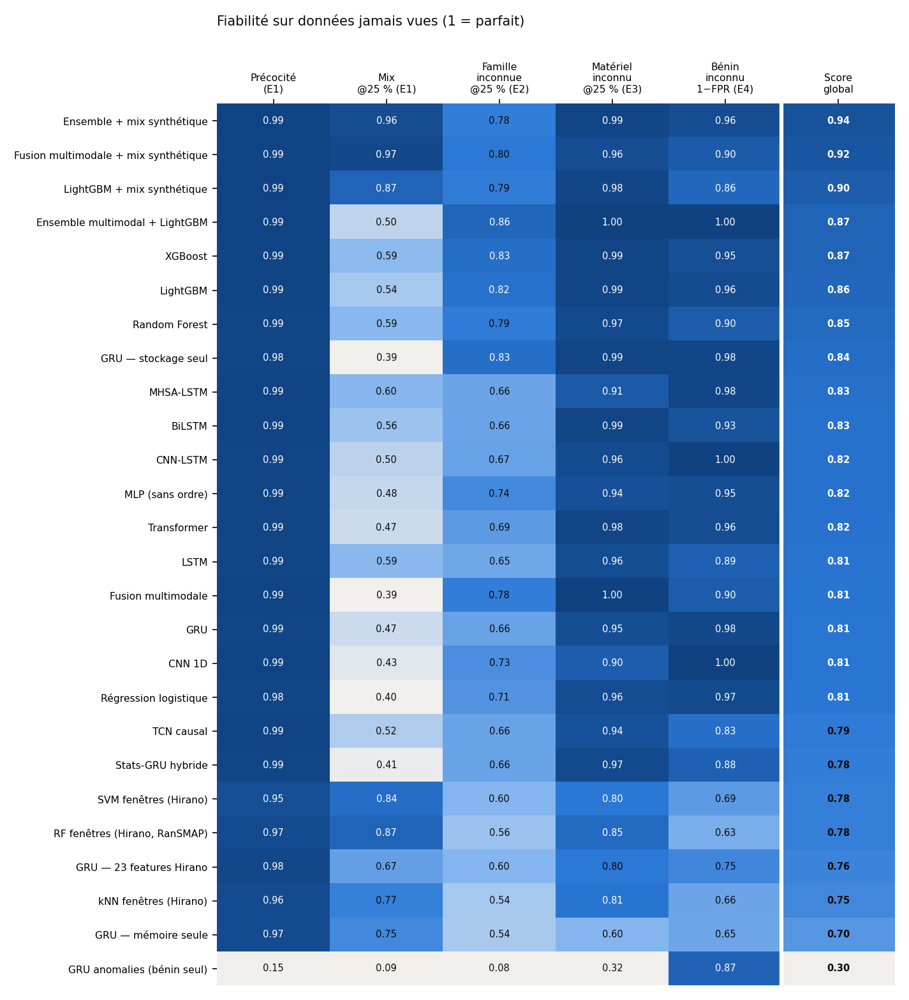
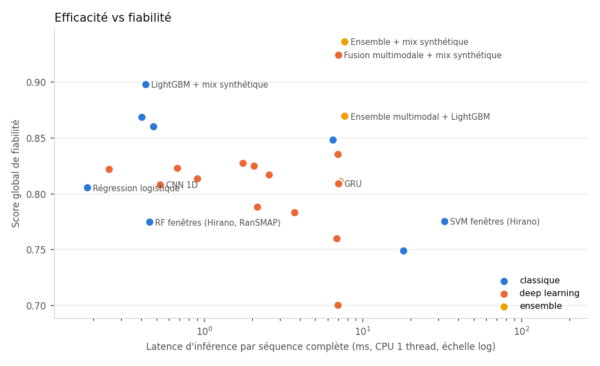
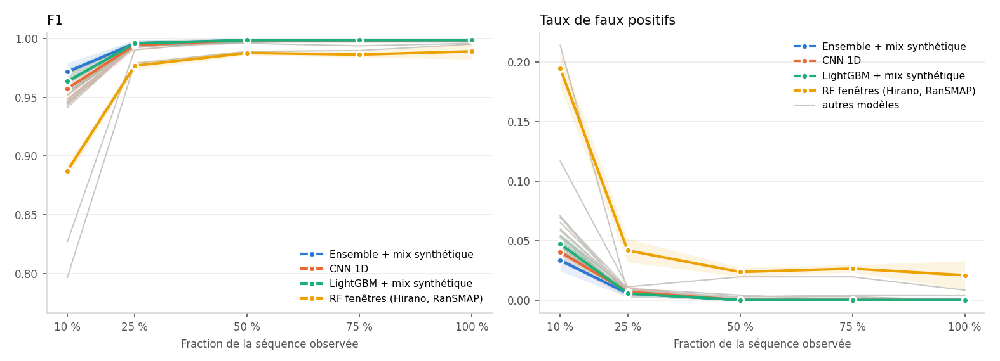
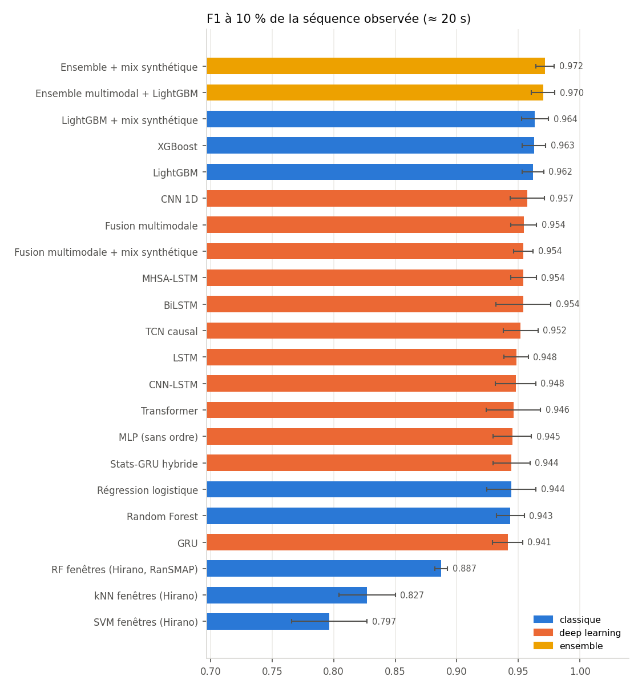
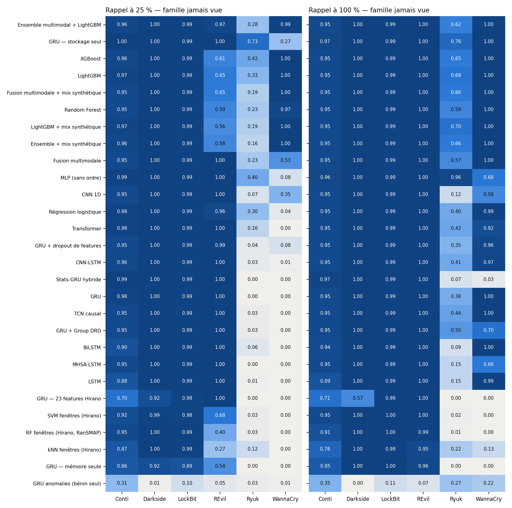

# Détection précoce de ransomware — comparaison des modèles (RanSMAP)

Rapport généré automatiquement par `scripts/make_report.py` à partir de `reports/results/*.csv`. Chaque ligne renvoie à des runs MLflow (voir `run_id` dans les CSV) : `mlflow ui --backend-store-uri sqlite:///mlflow.db`.

## Synthèse

**Données.** 1 970 exécutions RanSMAP (3,78 milliards d'événements disque/mémoire), 1 968 conservées
après nettoyage, transformées en séquences d'une mesure par seconde (≈ 194 s par exécution, 32 features).
26 modèles × 4 protocoles = **506 runs MLflow**, chacun avec ses prédictions par exécution.

### Réponses aux questions de recherche

* **RQ1 — détection sur séquence partielle : oui, dès 10 % (≈ 20 s).** Le meilleur modèle atteint
  F1 = 0,972 ± 0,007 à 10 % (rappel 0,976, FPR 3,3 %) et 0,996 à 25 %. Les modèles Deep Learning
  séquentiels atteignent F1 ≈ 0,95 à 10 % et ≈ 0,995 à 25 %. En fonctionnement continu (score recalculé
  toutes les 5 s, seuil calibré sur la validation), le délai médian avant alerte est de **10 à 17 s**,
  avec ≥ 99,7 % des ransomwares détectés pendant leur exécution.
* **RQ2 — compromis précocité / qualité.** Le gain est concentré entre 10 % et 25 % : au-delà de 25 %, tous
  les modèles sont ≥ 0,99 de F1. Le coût de la précocité est surtout en **faux positifs** : 3 à 6 % à 10 %,
  < 1 % dès 25 %. La référence du papier RanSMAP (RF, 23 features, fenêtres 10 s) monte à 19 % de faux
  positifs à 10 % et n'atteint F1 ≥ 0,95 qu'à 25 %. En ligne (une alerte à n'importe quel instant compte),
  le seuil opérationnel calibré sur la validation limite les fausses alertes à 4–9 % des exécutions bénignes
  sans perte de rappel.
* **RQ3 — famille inconnue : oui pour 4 familles sur 6, partiellement pour Ryuk et WannaCry.** En
  leave-one-family-out, Conti (et ses variantes), Darkside, LockBit et REvil inconnus restent détectés à
  ≥ 95 % sur la séquence complète par les meilleurs modèles. Pour REvil inconnu, les modèles séquentiels
  sont meilleurs tôt (100 % à 25 % contre ≈ 60 % pour le boosting). **Ryuk** (activité disque faible et lente)
  est la famille la plus difficile : à 25 %, au mieux 0,73 (GRU stockage seul), 0,2–0,4 pour la plupart des
  modèles ; sur la séquence complète 0,57–0,96 selon le modèle. **WannaCry** inconnu est détecté tôt par le
  boosting (100 % à 25 %) et en partie par la fusion multimodale (53 %), pas par les RNN classiques (≈ 0 %
  à 25 %, mais ≈ 100 % à la fin). Meilleur rappel moyen à 25 % : ensemble multimodal + LightGBM (0,865) ;
  les modèles de la référence RanSMAP plafonnent à 0,54–0,60.

### Comparaison des modèles (voir classement global ci-dessous)

1. **Les features comptent plus que l'architecture.** À architecture identique (GRU), nos 32 features
   (dont la part de *réécritures en place* et d'*écritures à forte entropie*) battent les 23 features du papier
   RanSMAP sur tous les axes : F1 @10 % 0,941 vs 0,918, famille inconnue 0,66 vs 0,60, matériel inconnu
   0,95 vs 0,80, faux positifs sur logiciel inconnu 2 % vs 25 %. Les features **mémoire seules généralisent
   mal** (matériel inconnu F1 0,60) : les motifs d'accès mémoire dépendent du CPU/RAM ; les features stockage
   sont les plus robustes.
2. **Deep Learning vs classique.** En distribution (E1), tous les modèles à features étendues sont à moins
   de 0,02 de F1 les uns des autres. Les écarts apparaissent hors distribution : le boosting (LightGBM,
   XGBoost) généralise mieux aux familles inconnues que les RNN/Transformer, tandis que la **fusion
   multimodale** (un encodeur par modalité + attention) est le meilleur modèle Deep Learning.
3. **Exécution simultanée (mix) : faiblesse corrigée par l'augmentation synthétique.** Quand un ransomware
   tourne en même temps qu'un logiciel légitime « ressemblant » (AESCrypt, SDelete, Zip), les modèles ne
   détectaient que 39–59 % des cas à 25 %. L'**augmentation par exécutions mixtes synthétiques** (somme des
   statistiques additives de deux exécutions du même matériel) porte ce rappel à **0,97** (fusion
   multimodale) et **0,96** (ensemble), et à 1,00 sur la séquence complète, sans dégrader E1.
4. **Matériel inconnu (E3).** Entraînés sur un seul CPU, les meilleurs modèles gardent F1 ≈ 0,99 sur l'autre
   CPU et sur le matériel `extra` (i5/i7, DDR5) ; la référence RanSMAP descend à 0,80–0,85 (à 25 %).
5. **Logiciel légitime inconnu (E4).** Les modèles de référence signalent à tort 31–37 % des exécutions d'une
   application jamais vue ; l'ensemble multimodal + LightGBM et le CNN-LSTM 0 %, la moitié de nos modèles
   ≤ 5 %. Points de vigilance : LightGBM + mix synthétique (14 % en moyenne, dû à SDelete inconnu signalé à
   82 %) et la fusion multimodale (≈ 10 %, dû à **Idle** inconnu signalé à 45–58 % : une machine au repos
   jamais vue lui paraît anormale). L'ensemble les compense en grande partie (Idle inconnu 1 %, SDelete inconnu 22 %).
6. **Efficacité.** Tous les modèles infèrent une séquence complète en < 8 ms sur un cœur CPU (LightGBM
   0,5 ms, fusion multimodale 7 ms, ensemble 7,7 ms), hors SVM/kNN de la référence (18–33 ms) :
   largement compatible avec une décision par seconde. Entraînement DL sur RTX 3050 : 13 s (MLP) à 106 s
   (BiLSTM) par modèle, 200 s avec l'augmentation mix ; boosting < 10 s sur CPU.
7. **Non supervisé.** Le détecteur d'anomalies entraîné sur le bénin seul (AUC 0,79 sur la séquence complète)
   ne suffit pas seul : le chiffrement intensif ressemble à AESCrypt/Zip. Il est conservé comme signal
   complémentaire `anomaly_probability` pour Hermes/JEV.
8. **Tentatives sans gain, conservées pour traçabilité** : Stats-GRU hybride, dropout de features et Group DRO
   n'améliorent pas la détection des familles inconnues.

### Recommandation

* **Modèle Deep Learning recommandé (inscrit au Model Registry, alias `champion`) : fusion multimodale +
  mix synthétique** — 2ᵉ score global (0,925), meilleur modèle 100 % DL, causal (utilisable en streaming),
  poids d'attention stockage/mémoire interprétables pour l'état du cas transmis à Hermes.
* **Meilleur système global : ensemble (fusion multimodale + LightGBM) + mix synthétique** — score global 0,936,
  F1 0,972 à 10 %, rappel mix 0,96, F1 ≈ 0,99 sur matériel inconnu, 4 % de FPR sur logiciel inconnu,
  pour 7,7 ms d'inférence.
* Variante sans augmentation à privilégier si la priorité est le zero-day et l'absence de faux positifs
  (ensemble multimodal + LightGBM : meilleur rappel famille inconnue, 0 % FPR sur logiciel inconnu).

### Limites

* 6 familles seulement : RQ3 repose sur 6 plis ; Ryuk montre qu'une famille « discrète » peut échapper.
* **Conti_06** n'a aucune activité de chiffrement dans RanSMAP (profil identique à Idle : débit d'écriture
  0,12 vs 0,15, 1 % d'écritures à forte entropie contre 67–75 % pour les autres variantes) : échantillon
  manifestement inopérant, indétectable comportementalement ; il plafonne le rappel « variantes » à 0,857
  pour tous les modèles. Conservé tel quel (pas d'exclusion a posteriori).
* Les mélanges synthétiques supposent l'additivité des statistiques ; ils sont validés sur les 100 vraies
  exécutions mixtes de RanSMAP, jamais utilisées à l'entraînement.
* Résultats valables pour les comportements présents dans RanSMAP (cf. section 13 du cahier des charges).

## Classement global multi-critères

Aucun modèle ne domine sur tous les axes : le classement moyenne cinq critères de fiabilité, chacun mesuré sur des données **jamais vues** : précocité (score précoce E1), robustesse à l'exécution simultanée d'un logiciel légitime (mix), détection d'une famille inconnue (E2), généralisation à un matériel inconnu (E3) et absence de fausse alerte sur un logiciel légitime inconnu (E4). Le détail de chaque protocole suit.

|                                      | Type          |   Précocité (E1) |   Mix @25 % (E1) |   Famille inconnue @25 % (E2) |   Matériel inconnu F1 @25 % (E3) |   1 − FPR bénin inconnu (E4) |   Score global |   Latence CPU (ms) |
|:-------------------------------------|:--------------|-----------------:|-----------------:|------------------------------:|---------------------------------:|-----------------------------:|---------------:|-------------------:|
| Ensemble + mix synthétique           | ensemble      |            0.993 |            0.96  |                         0.783 |                            0.988 |                        0.958 |          0.936 |              7.66  |
| Fusion multimodale + mix synthétique | deep learning |            0.989 |            0.974 |                         0.797 |                            0.96  |                        0.904 |          0.925 |              6.98  |
| LightGBM + mix synthétique           | classique     |            0.991 |            0.87  |                         0.786 |                            0.983 |                        0.861 |          0.898 |              0.425 |
| Ensemble multimodal + LightGBM       | ensemble      |            0.992 |            0.496 |                         0.865 |                            0.996 |                        1     |          0.87  |              7.66  |
| XGBoost                              | classique     |            0.99  |            0.588 |                         0.829 |                            0.988 |                        0.95  |          0.869 |              0.404 |
| LightGBM                             | classique     |            0.99  |            0.538 |                         0.823 |                            0.988 |                        0.962 |          0.86  |              0.477 |
| Random Forest                        | classique     |            0.987 |            0.594 |                         0.788 |                            0.971 |                        0.903 |          0.849 |              6.466 |
| GRU — stockage seul                  | deep learning |            0.984 |            0.39  |                         0.833 |                            0.988 |                        0.982 |          0.835 |              6.951 |
| MHSA-LSTM                            | deep learning |            0.989 |            0.598 |                         0.657 |                            0.91  |                        0.983 |          0.827 |              1.747 |
| BiLSTM                               | deep learning |            0.989 |            0.558 |                         0.658 |                            0.985 |                        0.935 |          0.825 |              2.05  |
| CNN-LSTM                             | deep learning |            0.988 |            0.5   |                         0.665 |                            0.963 |                        1     |          0.823 |              0.675 |
| MLP (sans ordre)                     | deep learning |            0.987 |            0.484 |                         0.744 |                            0.945 |                        0.951 |          0.822 |              0.25  |
| Transformer                          | deep learning |            0.987 |            0.468 |                         0.689 |                            0.984 |                        0.958 |          0.817 |              2.55  |
| LSTM                                 | deep learning |            0.988 |            0.592 |                         0.646 |                            0.956 |                        0.888 |          0.814 |              0.902 |
| Fusion multimodale                   | deep learning |            0.989 |            0.388 |                         0.782 |                            0.997 |                        0.901 |          0.811 |              7.184 |
| GRU                                  | deep learning |            0.986 |            0.47  |                         0.663 |                            0.951 |                        0.976 |          0.809 |              6.996 |
| CNN 1D                               | deep learning |            0.99  |            0.432 |                         0.727 |                            0.895 |                        0.999 |          0.808 |              0.527 |
| Régression logistique                | classique     |            0.985 |            0.4   |                         0.713 |                            0.96  |                        0.971 |          0.806 |              0.182 |
| TCN causal                           | deep learning |            0.988 |            0.52  |                         0.662 |                            0.941 |                        0.831 |          0.788 |              2.158 |
| Stats-GRU hybride                    | deep learning |            0.986 |            0.414 |                         0.664 |                            0.968 |                        0.885 |          0.783 |              3.706 |
| SVM fenêtres (Hirano)                | classique     |            0.95  |            0.838 |                         0.599 |                            0.801 |                        0.69  |          0.776 |             32.609 |
| RF fenêtres (Hirano, RanSMAP)        | classique     |            0.965 |            0.87  |                         0.561 |                            0.85  |                        0.629 |          0.775 |              0.451 |
| GRU — 23 features Hirano             | deep learning |            0.979 |            0.672 |                         0.6   |                            0.798 |                        0.751 |          0.76  |              6.857 |
| kNN fenêtres (Hirano)                | classique     |            0.963 |            0.774 |                         0.541 |                            0.812 |                        0.656 |          0.749 |             18.016 |
| GRU — mémoire seule                  | deep learning |            0.966 |            0.746 |                         0.536 |                            0.603 |                        0.651 |          0.7   |              6.932 |
| GRU anomalies (bénin seul)           | non supervisé |            0.155 |            0.094 |                         0.084 |                            0.318 |                        0.874 |          0.305 |              6.522 |

## E1 — Détection précoce (RQ1, RQ2)

Découpage par exécution (60/20/20, stratifié application × matériel), 5 graines. Moyenne ± écart-type. *Score précoce* = moyenne des F1 sur les 5 fractions.

| Modèle                               | Type          | F1 @10%       | F1 @25%       | F1 @50%       | F1 @75%       | F1 @100%      | FPR @25%      | AUC @25%      |   Score précoce |
|:-------------------------------------|:--------------|:--------------|:--------------|:--------------|:--------------|:--------------|:--------------|:--------------|----------------:|
| Ensemble + mix synthétique           | ensemble      | 0.972 ± 0.007 | 0.996 ± 0.003 | 0.999 ± 0.002 | 0.999 ± 0.002 | 0.999 ± 0.002 | 0.006 ± 0.003 | 0.999 ± 0.002 |           0.993 |
| Ensemble multimodal + LightGBM       | ensemble      | 0.970 ± 0.009 | 0.995 ± 0.003 | 0.998 ± 0.002 | 0.998 ± 0.002 | 0.999 ± 0.002 | 0.007 ± 0.005 | 0.999 ± 0.001 |           0.992 |
| LightGBM + mix synthétique           | classique     | 0.964 ± 0.011 | 0.996 ± 0.003 | 0.999 ± 0.002 | 0.999 ± 0.002 | 0.999 ± 0.002 | 0.006 ± 0.003 | 0.999 ± 0.001 |           0.991 |
| LightGBM                             | classique     | 0.962 ± 0.009 | 0.995 ± 0.004 | 0.998 ± 0.003 | 0.999 ± 0.002 | 0.999 ± 0.002 | 0.007 ± 0.005 | 1.000 ± 0.000 |           0.99  |
| XGBoost                              | classique     | 0.963 ± 0.010 | 0.994 ± 0.004 | 0.997 ± 0.003 | 0.997 ± 0.003 | 0.999 ± 0.002 | 0.008 ± 0.006 | 1.000 ± 0.000 |           0.99  |
| CNN 1D                               | deep learning | 0.957 ± 0.014 | 0.994 ± 0.004 | 0.999 ± 0.002 | 0.999 ± 0.002 | 0.999 ± 0.002 | 0.007 ± 0.005 | 0.999 ± 0.003 |           0.99  |
| MHSA-LSTM                            | deep learning | 0.954 ± 0.010 | 0.997 ± 0.002 | 0.999 ± 0.002 | 0.999 ± 0.002 | 0.999 ± 0.002 | 0.006 ± 0.003 | 0.999 ± 0.002 |           0.989 |
| BiLSTM                               | deep learning | 0.954 ± 0.022 | 0.997 ± 0.002 | 0.999 ± 0.002 | 0.999 ± 0.002 | 0.999 ± 0.002 | 0.006 ± 0.003 | 0.999 ± 0.002 |           0.989 |
| Fusion multimodale + mix synthétique | deep learning | 0.954 ± 0.008 | 0.994 ± 0.004 | 0.999 ± 0.002 | 0.999 ± 0.002 | 0.998 ± 0.002 | 0.008 ± 0.006 | 0.999 ± 0.002 |           0.989 |
| Fusion multimodale                   | deep learning | 0.954 ± 0.010 | 0.994 ± 0.004 | 0.998 ± 0.002 | 0.998 ± 0.002 | 0.999 ± 0.002 | 0.010 ± 0.006 | 0.999 ± 0.001 |           0.989 |
| TCN causal                           | deep learning | 0.952 ± 0.014 | 0.994 ± 0.004 | 0.999 ± 0.002 | 0.999 ± 0.002 | 0.999 ± 0.002 | 0.008 ± 0.006 | 0.999 ± 0.002 |           0.988 |
| CNN-LSTM                             | deep learning | 0.948 ± 0.016 | 0.994 ± 0.004 | 0.999 ± 0.002 | 0.999 ± 0.002 | 0.999 ± 0.002 | 0.007 ± 0.005 | 0.999 ± 0.003 |           0.988 |
| LSTM                                 | deep learning | 0.948 ± 0.010 | 0.994 ± 0.004 | 0.998 ± 0.003 | 0.999 ± 0.002 | 0.999 ± 0.002 | 0.008 ± 0.008 | 0.999 ± 0.002 |           0.988 |
| Transformer                          | deep learning | 0.946 ± 0.022 | 0.994 ± 0.002 | 0.999 ± 0.002 | 0.999 ± 0.002 | 0.999 ± 0.002 | 0.006 ± 0.003 | 0.999 ± 0.003 |           0.987 |
| Random Forest                        | classique     | 0.943 ± 0.011 | 0.996 ± 0.003 | 0.999 ± 0.002 | 0.999 ± 0.002 | 0.999 ± 0.002 | 0.006 ± 0.003 | 1.000 ± 0.000 |           0.987 |
| MLP (sans ordre)                     | deep learning | 0.945 ± 0.016 | 0.992 ± 0.005 | 0.999 ± 0.002 | 0.999 ± 0.002 | 0.999 ± 0.002 | 0.010 ± 0.006 | 0.999 ± 0.002 |           0.987 |
| Stats-GRU hybride                    | deep learning | 0.944 ± 0.015 | 0.994 ± 0.004 | 0.997 ± 0.002 | 0.999 ± 0.002 | 0.999 ± 0.002 | 0.010 ± 0.006 | 0.999 ± 0.002 |           0.986 |
| GRU                                  | deep learning | 0.941 ± 0.012 | 0.994 ± 0.004 | 0.999 ± 0.002 | 0.999 ± 0.002 | 0.999 ± 0.002 | 0.008 ± 0.006 | 0.999 ± 0.003 |           0.986 |
| Régression logistique                | classique     | 0.944 ± 0.020 | 0.994 ± 0.005 | 0.996 ± 0.003 | 0.994 ± 0.005 | 0.996 ± 0.004 | 0.004 ± 0.004 | 0.997 ± 0.004 |           0.985 |
| RF fenêtres (Hirano, RanSMAP)        | classique     | 0.887 ± 0.005 | 0.977 ± 0.004 | 0.988 ± 0.002 | 0.986 ± 0.002 | 0.989 ± 0.007 | 0.042 ± 0.010 | 0.997 ± 0.001 |           0.965 |
| kNN fenêtres (Hirano)                | classique     | 0.827 ± 0.023 | 0.990 ± 0.003 | 0.999 ± 0.002 | 0.999 ± 0.002 | 0.999 ± 0.002 | 0.007 ± 0.005 | 1.000 ± 0.000 |           0.963 |
| SVM fenêtres (Hirano)                | classique     | 0.797 ± 0.031 | 0.979 ± 0.012 | 0.989 ± 0.003 | 0.990 ± 0.002 | 0.995 ± 0.003 | 0.011 ± 0.008 | 0.998 ± 0.001 |           0.95  |
| GRU anomalies (bénin seul)           | non supervisé | 0.110 ± 0.057 | 0.066 ± 0.032 | 0.123 ± 0.028 | 0.233 ± 0.070 | 0.242 ± 0.085 | 0.046 ± 0.026 | 0.619 ± 0.013 |           0.155 |

### Fiabilité et fonctionnement en ligne

Le score est recalculé toutes les 5 s pendant l'exécution. Seuil opérationnel = plus bas seuil gardant ≤ 5 % de fausses alertes en ligne sur la validation. Délai = temps avant la première alerte sur les ransomwares détectés ; Brier/ECE = qualité de calibration du score de risque.

| Modèle                               | Seuil op.   | Rappel op. @25%   | FPR op. @25%   | Délai médian (s)   | Détection en ligne   | Fausses alertes en ligne   | Brier @100%   | ECE @100%     |
|:-------------------------------------|:------------|:------------------|:---------------|:-------------------|:---------------------|:---------------------------|:--------------|:--------------|
| Ensemble + mix synthétique           | 0.87 ± 0.02 | 0.997 ± 0.004     | 0.003 ± 0.004  | 10.0 ± 0.0         | 0.999 ± 0.003        | 0.061 ± 0.015              | 0.001 ± 0.002 | 0.002 ± 0.002 |
| Ensemble multimodal + LightGBM       | 0.88 ± 0.06 | 0.997 ± 0.004     | 0.004 ± 0.004  | 11.0 ± 2.2         | 0.997 ± 0.004        | 0.074 ± 0.034              | 0.001 ± 0.002 | 0.001 ± 0.002 |
| LightGBM + mix synthétique           | 0.98 ± 0.01 | 0.976 ± 0.008     | 0.000 ± 0.000  | 10.0 ± 0.0         | 0.997 ± 0.004        | 0.049 ± 0.016              | 0.001 ± 0.002 | 0.001 ± 0.002 |
| LightGBM                             | 0.99 ± 0.00 | 0.994 ± 0.006     | 0.003 ± 0.004  | 10.0 ± 0.0         | 0.999 ± 0.003        | 0.092 ± 0.013              | 0.001 ± 0.002 | 0.001 ± 0.002 |
| XGBoost                              | 0.96 ± 0.02 | 0.988 ± 0.013     | 0.000 ± 0.000  | 11.0 ± 2.2         | 0.999 ± 0.003        | 0.062 ± 0.023              | 0.001 ± 0.002 | 0.002 ± 0.002 |
| CNN 1D                               | 0.83 ± 0.03 | 0.994 ± 0.003     | 0.006 ± 0.003  | 14.0 ± 2.2         | 0.999 ± 0.003        | 0.065 ± 0.014              | 0.001 ± 0.002 | 0.001 ± 0.002 |
| MHSA-LSTM                            | 0.87 ± 0.04 | 0.999 ± 0.003     | 0.006 ± 0.003  | 15.0 ± 0.0         | 0.999 ± 0.003        | 0.062 ± 0.018              | 0.001 ± 0.002 | 0.001 ± 0.002 |
| BiLSTM                               | 0.81 ± 0.08 | 0.997 ± 0.004     | 0.006 ± 0.003  | 14.0 ± 2.2         | 0.999 ± 0.003        | 0.057 ± 0.018              | 0.001 ± 0.002 | 0.002 ± 0.002 |
| Fusion multimodale + mix synthétique | 0.88 ± 0.05 | 0.997 ± 0.004     | 0.004 ± 0.004  | 14.0 ± 2.2         | 0.999 ± 0.003        | 0.056 ± 0.011              | 0.002 ± 0.002 | 0.002 ± 0.002 |
| Fusion multimodale                   | 0.90 ± 0.04 | 0.997 ± 0.004     | 0.006 ± 0.006  | 15.0 ± 3.5         | 0.997 ± 0.004        | 0.069 ± 0.024              | 0.001 ± 0.002 | 0.001 ± 0.002 |
| TCN causal                           | 0.85 ± 0.04 | 0.997 ± 0.004     | 0.006 ± 0.003  | 17.0 ± 2.7         | 0.999 ± 0.003        | 0.042 ± 0.013              | 0.001 ± 0.002 | 0.001 ± 0.002 |
| CNN-LSTM                             | 0.84 ± 0.07 | 0.996 ± 0.004     | 0.006 ± 0.003  | 15.0 ± 0.0         | 0.999 ± 0.003        | 0.062 ± 0.035              | 0.001 ± 0.002 | 0.002 ± 0.001 |
| LSTM                                 | 0.83 ± 0.05 | 0.997 ± 0.004     | 0.008 ± 0.008  | 15.0 ± 0.0         | 0.999 ± 0.003        | 0.072 ± 0.028              | 0.001 ± 0.002 | 0.002 ± 0.001 |
| Transformer                          | 0.90 ± 0.08 | 0.985 ± 0.023     | 0.004 ± 0.004  | 16.0 ± 4.2         | 0.999 ± 0.003        | 0.057 ± 0.017              | 0.001 ± 0.002 | 0.001 ± 0.002 |
| Random Forest                        | 0.77 ± 0.02 | 0.964 ± 0.012     | 0.000 ± 0.000  | 10.0 ± 0.0         | 0.997 ± 0.004        | 0.074 ± 0.020              | 0.002 ± 0.002 | 0.012 ± 0.002 |
| MLP (sans ordre)                     | 0.95 ± 0.03 | 0.956 ± 0.034     | 0.000 ± 0.000  | 20.0 ± 3.5         | 0.997 ± 0.004        | 0.047 ± 0.035              | 0.001 ± 0.002 | 0.002 ± 0.001 |
| Stats-GRU hybride                    | 0.90 ± 0.02 | 0.997 ± 0.004     | 0.006 ± 0.003  | 14.0 ± 2.2         | 0.997 ± 0.004        | 0.075 ± 0.029              | 0.001 ± 0.002 | 0.002 ± 0.002 |
| GRU                                  | 0.91 ± 0.04 | 0.997 ± 0.004     | 0.004 ± 0.004  | 15.0 ± 0.0         | 0.999 ± 0.003        | 0.054 ± 0.028              | 0.001 ± 0.002 | 0.002 ± 0.001 |
| Régression logistique                | 0.99 ± 0.00 | 0.804 ± 0.019     | 0.001 ± 0.003  | 12.0 ± 2.7         | 0.994 ± 0.003        | 0.154 ± 0.019              | 0.003 ± 0.002 | 0.005 ± 0.002 |
| RF fenêtres (Hirano, RanSMAP)        | 0.66 ± 0.01 | 0.831 ± 0.054     | 0.006 ± 0.006  | 18.0 ± 5.7         | 0.996 ± 0.006        | 0.056 ± 0.019              | 0.029 ± 0.002 | 0.148 ± 0.004 |
| kNN fenêtres (Hirano)                | 0.85 ± 0.04 | 0.390 ± 0.138     | 0.000 ± 0.000  | 60.0 ± 14.6        | 0.949 ± 0.047        | 0.037 ± 0.015              | 0.009 ± 0.001 | 0.080 ± 0.002 |
| SVM fenêtres (Hirano)                | 0.84 ± 0.04 | 0.293 ± 0.104     | 0.000 ± 0.000  | 61.5 ± 10.2        | 0.854 ± 0.056        | 0.029 ± 0.016              | 0.017 ± 0.001 | 0.104 ± 0.003 |
| GRU anomalies (bénin seul)           | 0.91 ± 0.07 | 0.003 ± 0.004     | 0.001 ± 0.003  | 42.0 ± 46.0        | 0.065 ± 0.035        | 0.044 ± 0.027              | 0.220 ± 0.010 | 0.180 ± 0.018 |

### Tests externes (jamais vus à l'entraînement)

*Variantes* : 7 variantes de Conti ; *Mix* : ransomware exécuté en même temps qu'une application bénigne ; *Matériel inédit* : CPU i5/i7 gen12 et DDR5 (sous-ensemble `extra`).

| Modèle                               | Variantes Conti — rappel @25%   | Variantes Conti — rappel @100%   | Mix (rans.+bénin) — rappel @25%   | Mix — rappel @100%   | Matériel inédit — F1 @25%   | Matériel inédit — F1 @100%   | Matériel inédit — FPR @100%   |
|:-------------------------------------|:--------------------------------|:---------------------------------|:----------------------------------|:---------------------|:----------------------------|:-----------------------------|:------------------------------|
| Ensemble + mix synthétique           | 0.906 ± 0.022                   | 0.857 ± 0.000                    | 0.960 ± 0.012                     | 1.000 ± 0.000        | 0.979 ± 0.004               | 1.000 ± 0.000                | 0.000 ± 0.000                 |
| Ensemble multimodal + LightGBM       | 0.923 ± 0.024                   | 0.863 ± 0.008                    | 0.496 ± 0.029                     | 0.764 ± 0.036        | 0.988 ± 0.005               | 1.000 ± 0.000                | 0.000 ± 0.000                 |
| LightGBM + mix synthétique           | 0.951 ± 0.016                   | 0.863 ± 0.008                    | 0.870 ± 0.039                     | 0.954 ± 0.021        | 0.980 ± 0.003               | 1.000 ± 0.000                | 0.000 ± 0.000                 |
| LightGBM                             | 0.937 ± 0.016                   | 0.857 ± 0.000                    | 0.538 ± 0.013                     | 0.832 ± 0.018        | 0.985 ± 0.004               | 1.000 ± 0.000                | 0.000 ± 0.000                 |
| XGBoost                              | 0.914 ± 0.027                   | 0.857 ± 0.000                    | 0.588 ± 0.020                     | 0.844 ± 0.018        | 0.979 ± 0.003               | 1.000 ± 0.000                | 0.000 ± 0.000                 |
| CNN 1D                               | 0.880 ± 0.008                   | 0.860 ± 0.006                    | 0.432 ± 0.044                     | 0.572 ± 0.129        | 0.997 ± 0.002               | 1.000 ± 0.000                | 0.000 ± 0.000                 |
| MHSA-LSTM                            | 0.857 ± 0.000                   | 0.857 ± 0.000                    | 0.598 ± 0.086                     | 0.682 ± 0.069        | 0.996 ± 0.005               | 1.000 ± 0.000                | 0.000 ± 0.000                 |
| BiLSTM                               | 0.857 ± 0.000                   | 0.857 ± 0.000                    | 0.558 ± 0.107                     | 0.804 ± 0.076        | 0.989 ± 0.007               | 0.999 ± 0.002                | 0.002 ± 0.005                 |
| Fusion multimodale + mix synthétique | 0.886 ± 0.023                   | 0.857 ± 0.000                    | 0.974 ± 0.015                     | 1.000 ± 0.000        | 0.970 ± 0.007               | 0.998 ± 0.002                | 0.003 ± 0.005                 |
| Fusion multimodale                   | 0.917 ± 0.033                   | 0.883 ± 0.050                    | 0.388 ± 0.016                     | 0.698 ± 0.070        | 0.978 ± 0.007               | 0.996 ± 0.003                | 0.008 ± 0.006                 |
| TCN causal                           | 0.877 ± 0.016                   | 0.857 ± 0.000                    | 0.520 ± 0.078                     | 0.652 ± 0.078        | 0.990 ± 0.014               | 1.000 ± 0.000                | 0.000 ± 0.000                 |
| CNN-LSTM                             | 0.860 ± 0.006                   | 0.857 ± 0.000                    | 0.500 ± 0.072                     | 0.802 ± 0.095        | 0.993 ± 0.008               | 1.000 ± 0.000                | 0.000 ± 0.000                 |
| LSTM                                 | 0.860 ± 0.006                   | 0.857 ± 0.000                    | 0.592 ± 0.089                     | 0.834 ± 0.029        | 0.990 ± 0.008               | 0.998 ± 0.002                | 0.003 ± 0.003                 |
| Transformer                          | 0.957 ± 0.029                   | 0.883 ± 0.036                    | 0.468 ± 0.094                     | 0.592 ± 0.109        | 0.991 ± 0.005               | 1.000 ± 0.000                | 0.000 ± 0.000                 |
| Random Forest                        | 0.886 ± 0.000                   | 0.857 ± 0.000                    | 0.594 ± 0.009                     | 0.820 ± 0.019        | 0.978 ± 0.003               | 1.000 ± 0.000                | 0.000 ± 0.000                 |
| MLP (sans ordre)                     | 0.960 ± 0.023                   | 0.871 ± 0.014                    | 0.484 ± 0.022                     | 0.702 ± 0.027        | 0.991 ± 0.005               | 1.000 ± 0.000                | 0.000 ± 0.000                 |
| Stats-GRU hybride                    | 0.969 ± 0.033                   | 0.883 ± 0.050                    | 0.414 ± 0.044                     | 0.664 ± 0.074        | 0.988 ± 0.009               | 0.998 ± 0.003                | 0.004 ± 0.006                 |
| GRU                                  | 0.877 ± 0.022                   | 0.857 ± 0.000                    | 0.470 ± 0.023                     | 0.794 ± 0.032        | 0.993 ± 0.008               | 0.999 ± 0.001                | 0.001 ± 0.002                 |
| Régression logistique                | 0.963 ± 0.008                   | 0.880 ± 0.030                    | 0.400 ± 0.010                     | 0.594 ± 0.017        | 0.980 ± 0.005               | 1.000 ± 0.000                | 0.000 ± 0.000                 |
| RF fenêtres (Hirano, RanSMAP)        | 0.857 ± 0.000                   | 0.814 ± 0.020                    | 0.870 ± 0.012                     | 0.808 ± 0.023        | 0.969 ± 0.014               | 0.999 ± 0.002                | 0.000 ± 0.000                 |
| kNN fenêtres (Hirano)                | 0.737 ± 0.026                   | 0.771 ± 0.039                    | 0.774 ± 0.009                     | 0.792 ± 0.008        | 0.910 ± 0.012               | 0.976 ± 0.006                | 0.000 ± 0.000                 |
| SVM fenêtres (Hirano)                | 0.829 ± 0.017                   | 0.857 ± 0.000                    | 0.838 ± 0.011                     | 0.886 ± 0.009        | 0.931 ± 0.010               | 0.994 ± 0.002                | 0.000 ± 0.000                 |
| GRU anomalies (bénin seul)           | 0.671 ± 0.156                   | 0.857 ± 0.000                    | 0.094 ± 0.033                     | 0.386 ± 0.117        | 0.612 ± 0.054               | 0.798 ± 0.007                | 0.359 ± 0.040                 |

### Efficacité

Latence = inférence d'une séquence complète (≈ 200 s d'activité), batch 1, CPU mono-thread, mesurée à conditions identiques pour tous les modèles (`scripts/benchmark_latency.py`). Entraînement sur GPU (RTX 3050) pour le deep learning, CPU pour les modèles classiques.

| Modèle                               | Paramètres   | Taille (Ko)   | Entraînement (s)   |   Latence CPU 1 thread (ms) |   Latence p95 (ms) |
|:-------------------------------------|:-------------|:--------------|:-------------------|----------------------------:|-------------------:|
| Ensemble + mix synthétique           | 56,580       | 1597 ± 0      | 114.6 ± 39.5       |                        7.66 |               8.9  |
| Ensemble multimodal + LightGBM       | 56,580       | 1626 ± 1      | 76.4 ± 22.0        |                        7.66 |               8.9  |
| LightGBM + mix synthétique           | —            | 1375 ± 0      | 2.3 ± 1.4          |                        0.43 |               0.63 |
| LightGBM                             | —            | 1405 ± 1      | 2.6 ± 0.2          |                        0.48 |               0.72 |
| XGBoost                              | —            | 731 ± 12      | 3.4 ± 1.0          |                        0.4  |               0.62 |
| CNN 1D                               | 60,097       | 235 ± 0       | 28.7 ± 23.3        |                        0.53 |               0.79 |
| MHSA-LSTM                            | 50,242       | 196 ± 0       | 48.6 ± 18.2        |                        1.75 |               2.35 |
| BiLSTM                               | 157,825      | 617 ± 0       | 106.1 ± 22.3       |                        2.05 |               3.11 |
| Fusion multimodale + mix synthétique | 56,580       | 221 ± 0       | 199.3 ± 34.7       |                        6.98 |               7.9  |
| Fusion multimodale                   | 56,580       | 221 ± 0       | 85.2 ± 29.3        |                        7.18 |               8.18 |
| TCN causal                           | 127,809      | 499 ± 0       | 28.1 ± 8.9         |                        2.16 |               2.84 |
| CNN-LSTM                             | 47,937       | 187 ± 0       | 84.5 ± 44.9        |                        0.67 |               0.89 |
| LSTM                                 | 62,593       | 245 ± 0       | 99.4 ± 50.7        |                        0.9  |               1.78 |
| Transformer                          | 77,377       | 302 ± 0       | 50.4 ± 16.9        |                        2.55 |               3.42 |
| Random Forest                        | —            | 8411 ± 196    | 1.6 ± 0.1          |                        6.47 |               8.93 |
| MLP (sans ordre)                     | 14,593       | 57 ± 0        | 13.0 ± 2.8         |                        0.25 |               0.44 |
| Stats-GRU hybride                    | 41,986       | 164 ± 0       | 70.6 ± 25.0        |                        3.71 |               4.57 |
| GRU                                  | 48,001       | 188 ± 0       | 73.2 ± 34.9        |                        7    |               8.51 |
| Régression logistique                | —            | 6 ± 0         | 0.2 ± 0.1          |                        0.18 |               0.21 |
| RF fenêtres (Hirano, RanSMAP)        | —            | 627 ± 24      | 0.4 ± 0.0          |                        0.45 |               0.6  |
| kNN fenêtres (Hirano)                | —            | 2931 ± 0      | 0.0 ± 0.0          |                       18.02 |              22.13 |
| SVM fenêtres (Hirano)                | —            | 653 ± 18      | 9.1 ± 0.9          |                       32.61 |              37.04 |
| GRU anomalies (bénin seul)           | 45,856       | 179 ± 0       | 5.7 ± 1.0          |                        6.52 |               7.9  |

### Ablation : modalités et features

Même architecture (GRU), entrées différentes : stockage seul, mémoire seule, les 23 features du papier RanSMAP, et notre jeu étendu (32 features).

| Variante                      | F1 @10%       | F1 @25%       | F1 @50%       | F1 @75%       | F1 @100%      | Matériel inédit F1 @100%   |
|:------------------------------|:--------------|:--------------|:--------------|:--------------|:--------------|:---------------------------|
| GRU                           | 0.941 ± 0.012 | 0.994 ± 0.004 | 0.999 ± 0.002 | 0.999 ± 0.002 | 0.999 ± 0.002 | 0.999 ± 0.001              |
| GRU — stockage seul           | 0.937 ± 0.013 | 0.992 ± 0.004 | 0.997 ± 0.004 | 0.998 ± 0.003 | 0.999 ± 0.002 | 0.999 ± 0.001              |
| GRU — 23 features Hirano      | 0.918 ± 0.021 | 0.986 ± 0.006 | 0.997 ± 0.002 | 0.997 ± 0.002 | 0.996 ± 0.002 | 0.969 ± 0.053              |
| GRU — mémoire seule           | 0.884 ± 0.027 | 0.978 ± 0.013 | 0.986 ± 0.008 | 0.988 ± 0.009 | 0.991 ± 0.009 | 0.948 ± 0.022              |
| RF fenêtres (Hirano, RanSMAP) | 0.887 ± 0.005 | 0.977 ± 0.004 | 0.988 ± 0.002 | 0.986 ± 0.002 | 0.989 ± 0.007 | 0.999 ± 0.002              |

## E2 — Famille inconnue / zero-day (RQ3)

Leave-one-family-out : la famille testée (et pour Conti, ses 7 variantes) est totalement absente de l'entraînement et de la validation. Rappel = part des exécutions de la famille inconnue détectées ; FPR mesuré sur les exécutions bénignes de test.

|                                      |   rappel_moyen_p10 |   rappel_moyen_p25 |   rappel_moyen_p50 |   rappel_moyen_p75 |   rappel_moyen_p100 |   rappel_min_p100 |   fpr_moyen_p25 |   fpr_moyen_p100 |
|:-------------------------------------|-------------------:|-------------------:|-------------------:|-------------------:|--------------------:|------------------:|----------------:|-----------------:|
| Ensemble multimodal + LightGBM       |              0.807 |              0.865 |              0.879 |              0.913 |               0.927 |             0.625 |           0.003 |            0     |
| GRU — stockage seul                  |              0.791 |              0.833 |              0.918 |              0.952 |               0.953 |             0.758 |           0.009 |            0     |
| XGBoost                              |              0.817 |              0.829 |              0.873 |              0.927 |               0.932 |             0.65  |           0.002 |            0     |
| LightGBM                             |              0.809 |              0.823 |              0.867 |              0.93  |               0.937 |             0.683 |           0.005 |            0     |
| Fusion multimodale + mix synthétique |              0.751 |              0.797 |              0.87  |              0.919 |               0.933 |             0.658 |           0.006 |            0     |
| Random Forest                        |              0.789 |              0.788 |              0.83  |              0.902 |               0.922 |             0.592 |           0.003 |            0     |
| LightGBM + mix synthétique           |              0.833 |              0.786 |              0.827 |              0.918 |               0.94  |             0.7   |           0.002 |            0     |
| Ensemble + mix synthétique           |              0.786 |              0.783 |              0.834 |              0.919 |               0.933 |             0.658 |           0.002 |            0     |
| Fusion multimodale                   |              0.729 |              0.782 |              0.875 |              0.893 |               0.918 |             0.567 |           0.006 |            0     |
| MLP (sans ordre)                     |              0.728 |              0.744 |              0.839 |              0.89  |               0.931 |             0.678 |           0.003 |            0     |
| CNN 1D                               |              0.764 |              0.727 |              0.699 |              0.735 |               0.772 |             0.117 |           0.006 |            0     |
| Régression logistique                |              0.759 |              0.713 |              0.822 |              0.819 |               0.888 |             0.4   |           0.005 |            0     |
| Transformer                          |              0.725 |              0.689 |              0.7   |              0.745 |               0.881 |             0.425 |           0.003 |            0     |
| GRU + dropout de features            |              0.699 |              0.676 |              0.752 |              0.823 |               0.874 |             0.35  |           0.005 |            0     |
| CNN-LSTM                             |              0.744 |              0.665 |              0.698 |              0.831 |               0.886 |             0.408 |           0.007 |            0     |
| Stats-GRU hybride                    |              0.69  |              0.664 |              0.664 |              0.67  |               0.679 |             0.034 |           0.012 |            0     |
| GRU                                  |              0.709 |              0.663 |              0.704 |              0.852 |               0.888 |             0.383 |           0.007 |            0.001 |
| TCN causal                           |              0.74  |              0.662 |              0.669 |              0.848 |               0.897 |             0.442 |           0.005 |            0     |
| GRU + Group DRO                      |              0.728 |              0.661 |              0.661 |              0.724 |               0.857 |             0.5   |           0.009 |            0     |
| BiLSTM                               |              0.74  |              0.658 |              0.68  |              0.828 |               0.838 |             0.092 |           0.005 |            0     |
| MHSA-LSTM                            |              0.69  |              0.657 |              0.659 |              0.689 |               0.792 |             0.15  |           0.007 |            0     |
| LSTM                                 |              0.72  |              0.646 |              0.654 |              0.798 |               0.837 |             0.15  |           0.006 |            0     |
| GRU — 23 features Hirano             |              0.665 |              0.6   |              0.514 |              0.505 |               0.544 |             0     |           0.013 |            0.001 |
| SVM fenêtres (Hirano)                |              0.551 |              0.599 |              0.634 |              0.652 |               0.661 |             0     |           0.001 |            0.006 |
| RF fenêtres (Hirano, RanSMAP)        |              0.727 |              0.561 |              0.551 |              0.582 |               0.651 |             0     |           0.025 |            0.013 |
| kNN fenêtres (Hirano)                |              0.629 |              0.541 |              0.518 |              0.551 |               0.677 |             0.127 |           0.003 |            0     |
| GRU — mémoire seule                  |              0.552 |              0.536 |              0.575 |              0.608 |               0.634 |             0     |           0.016 |            0.003 |
| GRU anomalies (bénin seul)           |              0.084 |              0.084 |              0.119 |              0.17  |               0.169 |             0     |           0.051 |            0.034 |

Rappel @25 % par famille retirée :

| model                                |   Conti |   Darkside |   LockBit |   REvil |   Ryuk |   WannaCry |
|:-------------------------------------|--------:|-----------:|----------:|--------:|-------:|-----------:|
| BiLSTM                               |   0.9   |      1     |     0.992 |   1     |  0.058 |      0     |
| CNN 1D                               |   0.947 |      1     |     0.992 |   1     |  0.075 |      0.347 |
| CNN-LSTM                             |   0.958 |      1     |     0.992 |   1     |  0.033 |      0.008 |
| Ensemble + mix synthétique           |   0.963 |      1     |     0.992 |   0.583 |  0.158 |      1     |
| Ensemble multimodal + LightGBM       |   0.963 |      1     |     0.992 |   0.967 |  0.275 |      0.992 |
| GRU                                  |   0.984 |      1     |     0.992 |   1     |  0     |      0     |
| GRU anomalies (bénin seul)           |   0.311 |      0.008 |     0.1   |   0.05  |  0.025 |      0.008 |
| GRU + Group DRO                      |   0.947 |      1     |     0.992 |   1     |  0.025 |      0     |
| GRU + dropout de features            |   0.947 |      1     |     0.992 |   0.992 |  0.042 |      0.085 |
| GRU — 23 features Hirano             |   0.7   |      0.917 |     0.983 |   1     |  0     |      0     |
| GRU — mémoire seule                  |   0.863 |      0.917 |     0.892 |   0.542 |  0     |      0     |
| GRU — stockage seul                  |   1     |      1     |     0.992 |   1     |  0.733 |      0.271 |
| kNN fenêtres (Hirano)                |   0.868 |      1     |     0.992 |   0.267 |  0.117 |      0     |
| RF fenêtres (Hirano, RanSMAP)        |   0.947 |      1     |     0.992 |   0.4   |  0.025 |      0     |
| SVM fenêtres (Hirano)                |   0.921 |      0.992 |     0.983 |   0.675 |  0.025 |      0     |
| LightGBM + mix synthétique           |   0.974 |      1     |     0.992 |   0.558 |  0.192 |      1     |
| LSTM                                 |   0.879 |      1     |     0.992 |   1     |  0.008 |      0     |
| MHSA-LSTM                            |   0.947 |      1     |     0.992 |   1     |  0     |      0     |
| MLP (sans ordre)                     |   0.989 |      1     |     0.992 |   1     |  0.4   |      0.085 |
| Fusion multimodale                   |   0.947 |      1     |     0.992 |   1     |  0.225 |      0.525 |
| Fusion multimodale + mix synthétique |   0.947 |      1     |     0.992 |   0.65  |  0.192 |      1     |
| Stats-GRU hybride                    |   0.995 |      1     |     0.992 |   1     |  0     |      0     |
| LightGBM                             |   0.974 |      1     |     0.992 |   0.65  |  0.325 |      1     |
| Régression logistique                |   0.984 |      1     |     0.992 |   0.958 |  0.3   |      0.042 |
| Random Forest                        |   0.953 |      1     |     0.992 |   0.592 |  0.225 |      0.966 |
| XGBoost                              |   0.958 |      1     |     0.992 |   0.608 |  0.417 |      1     |
| TCN causal                           |   0.953 |      1     |     0.992 |   1     |  0.025 |      0     |
| Transformer                          |   0.984 |      1     |     0.992 |   1     |  0.158 |      0     |

## E3 — Matériel inconnu (robustesse)

Entraînement sur un seul CPU (toutes ses configurations RAM), test sur l'autre CPU et sur le matériel `extra` (i5/i7 gen12, DDR5). Mesure la dépendance des motifs d'accès au matériel.

| model                                |   f1_p25 (train celeron-gen6) |   f1_p25 (train i3-gen12) |   f1_p100 (train celeron-gen6) |   f1_p100 (train i3-gen12) |   extra_f1_p100 (train celeron-gen6) |   extra_f1_p100 (train i3-gen12) |   moyenne_f1_p100 |
|:-------------------------------------|------------------------------:|--------------------------:|-------------------------------:|---------------------------:|-------------------------------------:|---------------------------------:|------------------:|
| Ensemble multimodal + LightGBM       |                         0.996 |                     0.996 |                          0.999 |                      0.999 |                                1     |                            1     |             0.999 |
| XGBoost                              |                         0.983 |                     0.993 |                          0.999 |                      0.999 |                                1     |                            1     |             0.999 |
| Fusion multimodale                   |                         0.999 |                     0.996 |                          0.997 |                      0.999 |                                0.997 |                            0.986 |             0.998 |
| Ensemble + mix synthétique           |                         0.989 |                     0.987 |                          0.999 |                      0.996 |                                1     |                            1     |             0.997 |
| LightGBM + mix synthétique           |                         0.983 |                     0.983 |                          0.996 |                      0.999 |                                1     |                            1     |             0.997 |
| LightGBM                             |                         0.982 |                     0.994 |                          0.996 |                      0.999 |                                1     |                            1     |             0.997 |
| BiLSTM                               |                         0.996 |                     0.974 |                          0.996 |                      0.994 |                                0.994 |                            1     |             0.995 |
| GRU                                  |                         0.989 |                     0.913 |                          0.997 |                      0.99  |                                0.989 |                            1     |             0.994 |
| GRU — stockage seul                  |                         0.992 |                     0.985 |                          0.989 |                      0.997 |                                0.989 |                            0.994 |             0.993 |
| Fusion multimodale + mix synthétique |                         0.979 |                     0.941 |                          0.999 |                      0.985 |                                0.997 |                            0.981 |             0.992 |
| Transformer                          |                         0.99  |                     0.978 |                          0.999 |                      0.982 |                                1     |                            1     |             0.99  |
| Stats-GRU hybride                    |                         0.966 |                     0.97  |                          0.98  |                      0.994 |                                0.966 |                            0.997 |             0.987 |
| Random Forest                        |                         0.963 |                     0.98  |                          0.973 |                      0.999 |                                0.983 |                            1     |             0.986 |
| MLP (sans ordre)                     |                         0.967 |                     0.922 |                          0.999 |                      0.966 |                                0.994 |                            1     |             0.982 |
| Régression logistique                |                         0.94  |                     0.979 |                          0.976 |                      0.983 |                                0.972 |                            1     |             0.98  |
| CNN 1D                               |                         0.808 |                     0.982 |                          0.96  |                      0.993 |                                0.899 |                            1     |             0.976 |
| LSTM                                 |                         0.957 |                     0.956 |                          0.982 |                      0.965 |                                0.947 |                            0.994 |             0.973 |
| TCN causal                           |                         0.906 |                     0.975 |                          0.922 |                      0.997 |                                0.935 |                            1     |             0.96  |
| CNN-LSTM                             |                         0.938 |                     0.989 |                          0.919 |                      0.999 |                                0.929 |                            1     |             0.959 |
| MHSA-LSTM                            |                         0.938 |                     0.881 |                          0.977 |                      0.908 |                                0.941 |                            1     |             0.943 |
| RF fenêtres (Hirano, RanSMAP)        |                         0.881 |                     0.819 |                          0.903 |                      0.857 |                                0.831 |                            1     |             0.88  |
| kNN fenêtres (Hirano)                |                         0.797 |                     0.828 |                          0.899 |                      0.856 |                                0.652 |                            0.974 |             0.878 |
| SVM fenêtres (Hirano)                |                         0.765 |                     0.837 |                          0.861 |                      0.856 |                                0.605 |                            0.997 |             0.859 |
| GRU — 23 features Hirano             |                         0.774 |                     0.822 |                          0.801 |                      0.872 |                                0.781 |                            0.968 |             0.836 |
| GRU — mémoire seule                  |                         0.634 |                     0.572 |                          0.326 |                      0.726 |                                0.011 |                            0.933 |             0.526 |
| GRU anomalies (bénin seul)           |                         0.631 |                     0.006 |                          0.72  |                      0     |                                0.699 |                            0.802 |             0.36  |

## E4 — Application bénigne inconnue (faux positifs)

Une application légitime est retirée de l'entraînement ; on mesure la part de ses exécutions signalées à tort (FPR). AESCrypt (chiffrement), SDelete (effacement sécurisé) et Zip (compression) imitent le comportement d'un ransomware : ce sont les cas difficiles.

| model                                |   FPR moyen @25% |   FPR moyen @100% |   FPR max @100% |   Rappel rans. @25% |
|:-------------------------------------|-----------------:|------------------:|----------------:|--------------------:|
| CNN-LSTM                             |            0.089 |             0     |           0     |               0.997 |
| Ensemble multimodal + LightGBM       |            0.049 |             0     |           0     |               0.997 |
| CNN 1D                               |            0.094 |             0.001 |           0.008 |               0.997 |
| MHSA-LSTM                            |            0.168 |             0.017 |           0.092 |               0.997 |
| GRU — stockage seul                  |            0.064 |             0.018 |           0.092 |               0.997 |
| GRU                                  |            0.079 |             0.024 |           0.142 |               0.997 |
| Régression logistique                |            0.115 |             0.029 |           0.083 |               0.997 |
| LightGBM                             |            0.117 |             0.037 |           0.208 |               0.997 |
| Ensemble + mix synthétique           |            0.1   |             0.042 |           0.225 |               0.997 |
| Transformer                          |            0.067 |             0.042 |           0.1   |               0.995 |
| MLP (sans ordre)                     |            0.056 |             0.049 |           0.158 |               0.995 |
| XGBoost                              |            0.122 |             0.05  |           0.283 |               0.997 |
| BiLSTM                               |            0.067 |             0.065 |           0.25  |               0.995 |
| Fusion multimodale + mix synthétique |            0.079 |             0.096 |           0.45  |               0.997 |
| Random Forest                        |            0.107 |             0.097 |           0.575 |               0.997 |
| Fusion multimodale                   |            0.043 |             0.099 |           0.583 |               0.997 |
| LSTM                                 |            0.183 |             0.112 |           0.433 |               0.994 |
| Stats-GRU hybride                    |            0.108 |             0.115 |           0.683 |               0.995 |
| GRU anomalies (bénin seul)           |            0.089 |             0.126 |           0.433 |               0.046 |
| LightGBM + mix synthétique           |            0.153 |             0.139 |           0.817 |               0.997 |
| TCN causal                           |            0.121 |             0.169 |           1     |               0.997 |
| GRU — 23 features Hirano             |            0.393 |             0.249 |           1     |               0.978 |
| SVM fenêtres (Hirano)                |            0.382 |             0.31  |           1     |               0.971 |
| kNN fenêtres (Hirano)                |            0.428 |             0.344 |           1     |               0.992 |
| GRU — mémoire seule                  |            0.479 |             0.349 |           1     |               0.983 |
| RF fenêtres (Hirano, RanSMAP)        |            0.588 |             0.371 |           1     |               0.994 |

FPR @100 % par application retirée :

| model                                |   AESCrypt |   Firefox |   Idle |   Office |   SDelete |   Zip |
|:-------------------------------------|-----------:|----------:|-------:|---------:|----------:|------:|
| BiLSTM                               |      0.017 |     0     |  0.125 |        0 |     0.25  | 0     |
| CNN 1D                               |      0     |     0     |  0.008 |        0 |     0     | 0     |
| CNN-LSTM                             |      0     |     0     |  0     |        0 |     0     | 0     |
| Ensemble + mix synthétique           |      0     |     0     |  0.008 |        0 |     0.225 | 0.017 |
| Ensemble multimodal + LightGBM       |      0     |     0     |  0     |        0 |     0     | 0     |
| GRU                                  |      0     |     0     |  0.142 |        0 |     0     | 0     |
| GRU anomalies (bénin seul)           |      0.433 |     0.025 |  0     |        0 |     0.058 | 0.242 |
| GRU — 23 features Hirano             |      0.45  |     0.008 |  0     |        0 |     1     | 0.033 |
| GRU — mémoire seule                  |      0.575 |     0.017 |  0     |        0 |     1     | 0.5   |
| GRU — stockage seul                  |      0     |     0.017 |  0.092 |        0 |     0     | 0     |
| kNN fenêtres (Hirano)                |      0.367 |     0.642 |  0     |        0 |     1     | 0.058 |
| RF fenêtres (Hirano, RanSMAP)        |      0.508 |     0.558 |  0     |        0 |     1     | 0.158 |
| SVM fenêtres (Hirano)                |      0.383 |     0.433 |  0     |        0 |     1     | 0.042 |
| LightGBM + mix synthétique           |      0     |     0.017 |  0     |        0 |     0.817 | 0     |
| LSTM                                 |      0.433 |     0     |  0.242 |        0 |     0     | 0     |
| MHSA-LSTM                            |      0.092 |     0.008 |  0     |        0 |     0     | 0     |
| MLP (sans ordre)                     |      0     |     0.008 |  0.125 |        0 |     0.158 | 0     |
| Fusion multimodale                   |      0     |     0     |  0.583 |        0 |     0.008 | 0     |
| Fusion multimodale + mix synthétique |      0     |     0     |  0.45  |        0 |     0.1   | 0.025 |
| Stats-GRU hybride                    |      0     |     0.008 |  0.683 |        0 |     0     | 0     |
| LightGBM                             |      0     |     0.017 |  0     |        0 |     0.208 | 0     |
| Régression logistique                |      0     |     0.017 |  0.075 |        0 |     0     | 0.083 |
| Random Forest                        |      0     |     0.008 |  0     |        0 |     0.575 | 0     |
| XGBoost                              |      0     |     0.017 |  0     |        0 |     0.283 | 0     |
| TCN causal                           |      0     |     0.017 |  1     |        0 |     0     | 0     |
| Transformer                          |      0     |     0     |  0.092 |        0 |     0.1   | 0.058 |
